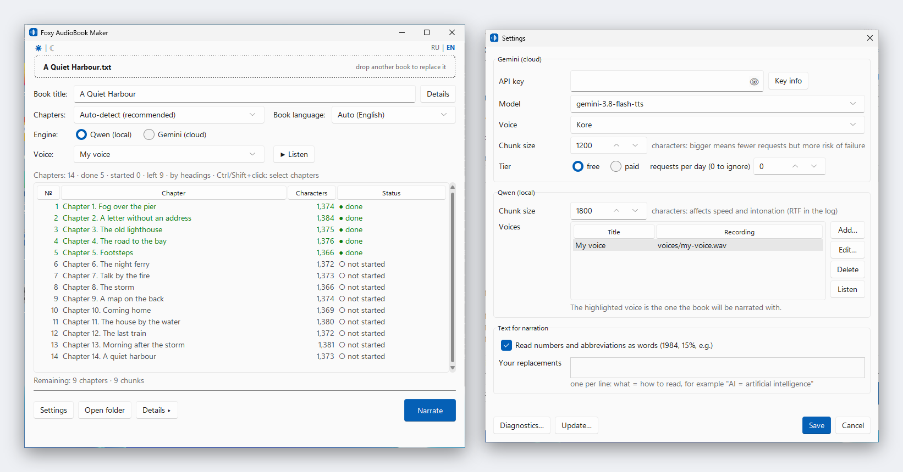

# Foxy AudioBook Maker

[English](README.md) · [Русский](README.ru.md)

Turns a book (`.txt`, EPUB or FB2) into audio: **one MP3 per chapter**. One Python program finds the chapters, narrates
them, and if something goes wrong (power cut, crash, closed window) it simply continues where it stopped.

**In short:** download **FoxyAudioBookMaker.exe** from [Releases](https://github.com/ed9ward/Foxy_AudioBook_Maker/releases/latest), put it into an empty folder, double-click it,
drop your book onto the window and press the big button. Details are below.

You choose how the voice is made:

| | **Qwen (on your PC)** | **Gemini (Google cloud)** |
|---|---|---|
| Needs | NVIDIA graphics card (8 GB video memory recommended), about 15 GB of free disk space | Internet and a free API key |
| Voice | Copies a voice from your own recording | 30 ready-made voices |
| Cost | Free | Small free tier, then pay per use |
| Privacy | The text never leaves your PC | The text is sent to Google |

> The window speaks **English or Russian**. It follows your system language on the first start; the **RU | EN** switch in
> the top-right corner changes it at any time and the choice is remembered. Your books can be in any language the chosen
> engine supports.

## The easy way: FoxyAudioBookMaker.exe (Windows 10/11)

1. Download **FoxyAudioBookMaker.exe** from [Releases](https://github.com/ed9ward/Foxy_AudioBook_Maker/releases/latest) and put it into an empty folder with a short path without
   Cyrillic or spaces, for example `C:\audiobook`. Everything the program creates will live in this folder.
2. Double-click it. The program is not signed, so Windows may show "Windows protected your PC": click **More info** >
   **Run anyway**.
3. If Python 3.14 is missing, the program offers to install it from python.org (about 32 MB, for your account only, no
   administrator rights). Then it asks to create its working folder `.venv` next to the exe and installs the libraries,
   showing what it is doing. Next starts open the window right away.
4. For Qwen or Gemini, see steps 2, 3, 5 and 6 below; installing Python and downloading the ZIP are not needed.

Updates: **Settings… > Update…** shows what is new, downloads the new exe and restarts the program by itself.

## Setup without the exe (running the script)

You do this once.

1. **Install Python 3.14** from <https://www.python.org/downloads/>. Keep the default options (the "py launcher" must
   stay ticked). Python 3.13 and 3.12 are also accepted if 3.14 is not installed, and an existing `.venv` on 3.12 or 3.13 keeps working.
2. **Qwen only:** update your NVIDIA driver (version 570 or newer; check with `nvidia-smi` in a terminal) and install the
   [Visual C++ Redistributable](https://aka.ms/vs/17/release/vc_redist.x64.exe).
3. **Gemini only:** get a free API key at <https://aistudio.google.com/apikey> (sign in with a Google account, press
   "Create API key"). Keep it private.
4. **Download the program:** on this page press the green **Code** button, then **Download ZIP**, and unpack it into a
   short folder without Cyrillic or spaces, for example `C:\audiobook`.
5. **Get your book as EPUB, FB2 or a plain `.txt`** (UTF-8; in Notepad: *Save as* > *Encoding: UTF-8*). EPUB and FB2
   open directly: chapters and the title come from the book itself. Other formats (PDF, DOCX, MOBI) must be converted
   first, for example with the free program Calibre; copy-protected (DRM) books cannot be opened. You can keep the file
   anywhere: you will drop it onto the window.
6. **Qwen only:** prepare a clean recording of the voice you want (one person, no music or noise, from a few seconds up to
   about half a minute, WAV/FLAC/MP3) and write down the exact words spoken in it. In **Settings… > Voices > Add…** you
   pick the file, type the words and give the voice a name; you can keep several voices. Use only voices you have the
   right to copy.

## Running it

Double-click **`start.bat`** (or in a terminal inside the folder: `py -3.14 audiobook_master.py`). The first time, it
offers to create its own private Python environment (`.venv`) in the folder: press **Enter** (yes). Then the program
window opens and the black console window goes away.

1. **Drop your book** onto the window, or click the dashed area to choose the file.
2. **Check the book title.** It comes from the file name and becomes the name of the result folder. If the file is called
   `1.txt` or has a placeholder name (only digits, "New Text Document"), the field stays empty and the big button is
   locked until you type a title yourself (digits are fine, for example `1984`).
3. Choose the engine (**Qwen** or **Gemini**) and look at the chapters table. If the split looks wrong, pick another
   method in the list at the right. To narrate only some chapters (for example, to test a voice on one of them), select
   them with Ctrl or Shift + click: the button then says **Narrate selected**.

   Next to the voice, **▶ Listen** plays the first two sentences of the selected chapter with the current engine, voice
   and language (each Gemini test uses one request from the daily limit). **Book language** is detected from the text
   (shown as "Auto (…)") and can be changed. Each book remembers its language, voice and Gemini model and picks them again
   when you open it. **Details…** next to the title holds the author, series, description and cover that are written into
   the MP3 files (taken from EPUB/FB2 automatically).
4. Press **Narrate**.
   - **Qwen:** choose a voice in the **Voice** list under the engine (with no voices yet, the list offers to add one). If
     packages are
     missing (about 3 GB), it offers to install them into the program folder and shows the progress in the log; then the
     run continues by itself. The voice model (about 4 GB) is downloaded on the first run.
   - **Gemini:** paste your API key when asked, then check the estimate (requests, audio length, cost) and confirm.
5. Watch the progress bar: it shows the time left, the window title shows the percentage, and a sound plus a flashing
   taskbar button tell you when it is finished. The log is folded into one line: click **Details** to open it (it opens
   by itself only on errors). While the work runs, the big button turns into **Stop**: it finishes the current chunk and
   keeps the progress. **Open folder** opens the result.

In the table, double-click a finished chapter to play its MP3; right-click a chapter for **Narrate again**, which deletes
that chapter's MP3 and half-done parts so it is narrated from scratch.

**Settings…** holds the defaults: Gemini key, model, voice, chunk size, tier and daily limit, Qwen chunk size, your
voices (recording, its text and a name), how the text is read (see below), the look of the window (light, dark or as in
the system), plus buttons to check the key, see limits and costs, **Diagnostics…** (versions, paths and the graphics card
as text you can copy into a bug report) and **Update…**. The window remembers its size and position.

The result appears in a **folder named after your book**, next to the program: one MP3 per chapter. Everything else
(`chapters/`, `temp_chunks/`) is service data inside that folder. You can narrate several books, each gets its own
folder. A book can be narrated by one copy of the program at a time. Every MP3 is tagged with the book title and the
chapter name and number, so audio players sort and label the chapters properly.

**Stopped or crashed?** Just run it again and drop the same book. Finished parts are kept, only the missing ones are
narrated, and the chapter is assembled into one MP3 automatically. Changing the voice, language or text of a half-finished
chapter restarts that chapter, so voices never get mixed.

## How the book is split into chapters

The program recognises `Chapter 5`, `CHAPTER ONE`, `Глава пятая`, `Kapitel 2`, `第一章`, `Prologue`/`Epilogue`, Markdown
`#` headings, bare numbers (`1`, `II.`) or your own pattern. It skips a table of contents, keeps any text before the first
chapter, and merges "Part I" headings into the following chapter. If a book has no headings, it is cut into equal parts.
You see the result in the table before anything is narrated.

## How the text is read

Before narration the program rewrites what a voice tends to stumble on: numbers and dates become words ("in 1984" →
"in nineteen eighty-four", "в 1984 году" → "в тысяча девятьсот восемьдесят четвёртом году"), as do percentages, money,
ordinals, centuries, times and common abbreviations ("e.g.", "т. е.", "и т. д."). The book text itself is not changed.
In **Settings…** you can switch this off and add your own replacements, one per line: `AI = artificial intelligence`.
Changing the rules restarts only chapters that are half done.

## Speed

- **Gemini, paid tier:** three chunks are narrated at the same time, so a book takes roughly a third of the time. On the
  free tier requests are spaced at least 20 seconds apart to respect Google's per-minute limit.
- MP3 files are assembled in the background while the next chapter is already being narrated.
- **Qwen:** the log shows the speed of every chunk (RTF, lower is faster) and a summary after each chapter. The chunk size
  in the settings affects both speed and intonation: try a few values on one chapter and compare.
- **Graphics cards:** RTX 20 and newer use Triton acceleration; if it does not work on a card, the program switches it
  off by itself and carries on, just more slowly. GTX 10xx, 9xx and Titan V get a PyTorch build for older cards without
  Triton: it works, but slowly, so Gemini is the faster choice there.

## Gemini notes

- Free keys have **small daily limits** (check yours in Google AI Studio), and Google may use free-tier text to improve its
  products. Paid use is billed by audio length, roughly $0.5-2 per hour of audio at the time of writing (prices change,
  check Google's pricing page).
- The settings let you pick the model, the voice, the chunk size (larger chunks mean fewer requests) and your tier. The
  program counts its own requests, shows the cost of each chunk and stops cleanly at your daily limit; run it again the
  next day to continue. It cannot see your real remaining quota or balance: AI Studio and Google Cloud Billing show those.
- Voice cloning is not available in Gemini mode, only in Qwen mode.
- On Windows the API key is stored encrypted for your Windows account. If you copy the folder to another computer, the
  program asks for the key again. If Windows fails to encrypt the key, it is not written to the file at all: it works until
  the program is closed, and you can enter it again or set the `GEMINI_API_KEY` environment variable.
- After an update the program brings older libraries up to the versions it needs: small ones automatically at start, the Qwen components when you press the narrate button (it offers the installation; the PyTorch build is never replaced by itself).
- Only one copy of the program can run from a folder (a second one says so and closes): settings, the cost log and the cover and preview files are shared. Your language and split choices for a book are saved at once.
- Updates come from the latest GitHub release and are checked against the release's `SHA256SUMS` before anything is replaced; an older version is never installed. The previous version stays next to the new one as `audiobook_master.py.prev` (or `FoxyAudioBookMaker.exe.prev`). To roll back, close the program and rename that file back.

## What is in the folder

Everything the program creates stays **inside its own folder**; nothing is installed system-wide.

| Path | What |
|---|---|
| `<Book title>/` | Your result: MP3 per chapter, plus `chapters/` (chapter texts) and `temp_chunks/` (progress, removed when a chapter is done) |
| `.venv/` | The program's private Python environment (about 5 GB with Qwen, about 0.3 GB with Gemini only) |
| `models/` | Downloaded voice model (about 4 GB, Qwen only) |
| `.cache/` | Temporary files and compiled kernels |
| `settings.json` | Your settings, language, window position and look. The API key in it is encrypted on Windows; still, never share or upload this file. If it is damaged, a copy is kept next to it as `settings.json.bad` |
| `usage.json` | Log of the Gemini requests the program made |

To remove everything, delete the folder.

## Updating

Open **Settings… > Update…**: the program checks GitHub, shows what is new and replaces itself; then close and start it
again. You can also download the new ZIP and copy `audiobook_master.py` and `start.bat` over the old ones. Your settings,
books, models and `.venv` stay as they are.

## If something goes wrong

| Problem | What to do |
|---|---|
| `py` is not recognised | Reinstall Python 3.14 with the "py launcher" ticked, or run `python audiobook_master.py` |
| The program says this Python has no Tk | Tk is the window library and is part of Python: reinstall Python 3.14 from python.org with the default options |
| Dropping a file onto the window does nothing | Click the dashed area and choose the file instead (TXT, EPUB or FB2) |
| The window says the format is not supported | Supported formats: TXT, EPUB, FB2. Convert other formats to EPUB or a plain `.txt` (UTF-8), for example with Calibre |
| The window says the file is too large for a book | An EPUB/FB2 exceeds the safety limits (over 20,000 files inside, over 64 MB in one chapter file or 256 MB in total, over 100 million characters of text). Real books never reach them; a genuine one can be re-saved with Calibre |
| An EPUB or FB2 does not open | The file is damaged or copy-protected (DRM): convert it with Calibre to EPUB or `.txt` |
| "This book is already being narrated by another run" | Close the other copy of the program, or wait until it finishes |
| DLL error when loading `torch` or `triton` | Install the Visual C++ Redistributable (step 2 of Setup) |
| The first Qwen start seems stuck | It is downloading the model and compiling kernels once; wait |
| The model will not download | Remove the environment variable `HF_HUB_OFFLINE` if you have it, and check your internet access |
| pip warns about `~umpy` | Harmless. If the window asks to restart after an install, close it and start again |
| Gemini says 429 | A limit was hit: the program waits and retries, or stops at the daily limit; run it again later |
| Anything else | Open Settings > **Diagnostics…**, copy the text and open an issue with a short description |

## Command line

The program always opens its window. Options: `--lang en|ru` (interface language, it is remembered) and `--book PATH`
(open this book right away).

## Code signing policy

Free code signing provided by [SignPath.io](https://about.signpath.io), certificate by [SignPath Foundation](https://signpath.org).

*Status: the application to SignPath Foundation is pending. Releases are unsigned until it is approved; this section is updated when signing starts.*

- Only `FoxyAudioBookMaker.exe` is signed. It is built from this repository by the [release workflow](.github/workflows/release.yml) on GitHub Actions, and every release needs manual approval before signing.
- Committers and reviewers: [ed9ward](https://github.com/ed9ward)
- Approvers: [ed9ward](https://github.com/ed9ward)

## Privacy policy

This program will not transfer any information to other networked systems unless specifically requested by the user or the person installing or operating it. It has no telemetry, no analytics and no accounts. The network is used only for what you start yourself:

- First start of `FoxyAudioBookMaker.exe`: after you confirm, it downloads Python from python.org (installed for your account only, `PATH` is not changed) and the libraries from PyPI and download.pytorch.org. The Qwen model is downloaded from Hugging Face the first time you use Qwen.
- Gemini engine (only if you choose it and enter your own API key): the text of the book is sent to Google's Gemini API in chunks, see [Google's terms](https://ai.google.dev/gemini-api/terms). The key stays on your computer (encrypted for your Windows account).
- The **Update…** button asks GitHub for the latest release and downloads it.

The privacy policies of python.org, PyPI, PyTorch, Hugging Face, Google and GitHub apply to those services.

## Uninstalling

Close the program and delete its folder: it holds everything the program created (`.venv`, `models`, settings, results). If the exe installed Python for you, remove it in Windows **Settings → Apps → Installed apps → Python 3.14.10**.

## License

MIT, see [LICENSE](LICENSE).
