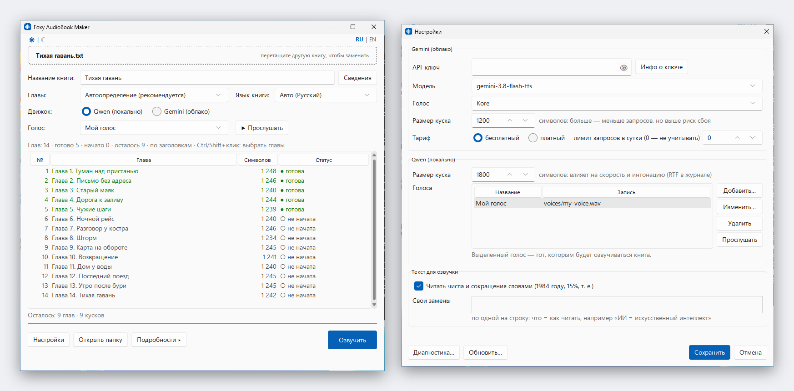

# Foxy AudioBook Maker

[English](README.md) · [Русский](README.ru.md)

Превращает книгу (`.txt`, EPUB или FB2) в аудио: **один MP3 на каждую главу**. Одна программа на Python находит главы,
озвучивает их, а если что-то пошло не так (отключили свет, сбой, закрыли окно), просто продолжает с места остановки.

**Коротко:** скачайте **FoxyAudioBookMaker.exe** из раздела [Releases](https://github.com/ed9ward/Foxy_AudioBook_Maker/releases/latest), положите его в пустую папку, запустите
двойным щелчком, перетащите книгу в окно и нажмите большую кнопку. Подробности ниже.

Голос можно делать двумя способами:

| | **Qwen (на вашем компьютере)** | **Gemini (облако Google)** |
|---|---|---|
| Что нужно | Видеокарта NVIDIA (рекомендуется 8 ГБ видеопамяти), около 15 ГБ свободного места на диске | Интернет и бесплатный API-ключ |
| Голос | Копирует голос из вашей записи | 30 готовых голосов |
| Цена | Бесплатно | Небольшой бесплатный лимит, дальше оплата за использование |
| Приватность | Текст не покидает компьютер | Текст отправляется в Google |

> Окно говорит **по-русски или по-английски**: при первом запуске язык берётся из системы, а переключатель **RU | EN** в
> правом верхнем углу меняет его в любой момент (выбор запоминается).

## Проще всего: FoxyAudioBookMaker.exe (Windows 10/11)

1. Скачайте **FoxyAudioBookMaker.exe** из раздела [Releases](https://github.com/ed9ward/Foxy_AudioBook_Maker/releases/latest) и положите в пустую папку с коротким путём без кириллицы
   и пробелов, например `C:\audiobook`. Всё, что создаёт программа, будет лежать в этой папке.
2. Запустите двойным щелчком. Программа не подписана, поэтому Windows может написать «Система Windows защитила ваш
   компьютер»: нажмите **Подробнее** > **Выполнить в любом случае**.
3. Если нет Python 3.14, программа предложит поставить его с python.org (около 32 МБ, только для вашей учётной записи, без
   прав администратора). Затем спросит, можно ли создать рабочую папку `.venv` рядом с exe, и поставит библиотеки,
   показывая, что делает. Следующие запуски сразу открывают окно.
4. Для Qwen или Gemini смотрите шаги 2, 3, 5 и 6 ниже; ставить Python и скачивать ZIP не нужно.

Обновление: **Настройки… > Обновить…** покажет, что нового, скачает новый exe и сама перезапустит программу.

## Подготовка без exe (запуск скрипта)

Делается один раз.

1. **Установите Python 3.14** с <https://www.python.org/downloads/>. Параметры оставьте по умолчанию (галочка «py launcher»
   должна остаться). Python 3.13 и 3.12 тоже подойдут, если 3.14 нет, а готовое `.venv` на 3.12 или 3.13 продолжит работать.
2. **Только для Qwen:** обновите драйвер NVIDIA (версия 570 или новее; проверить можно командой `nvidia-smi` в терминале) и
   установите [Visual C++ Redistributable](https://aka.ms/vs/17/release/vc_redist.x64.exe).
3. **Только для Gemini:** получите бесплатный API-ключ на <https://aistudio.google.com/apikey> (войдите аккаунтом Google,
   нажмите «Create API key»). Держите ключ в секрете.
4. **Скачайте программу:** на этой странице нажмите зелёную кнопку **Code**, затем **Download ZIP** и распакуйте в короткую
   папку без кириллицы и пробелов, например `C:\audiobook`.
5. **Подготовьте книгу в EPUB, FB2 или простом `.txt`** (UTF-8; в Блокноте: «Сохранить как» > «Кодировка: UTF-8»). EPUB
   и FB2 открываются сразу: главы и название берутся из самой книги. Другие форматы (PDF, DOCX, MOBI) сначала нужно
   перевести, например бесплатной программой Calibre; книги с защитой (DRM) открыть нельзя. Файл может лежать где угодно:
   вы перетащите его в окно.
6. **Только для Qwen:** подготовьте чистую запись нужного голоса (один человек, без музыки и шума, от нескольких секунд до
   примерно полуминуты, WAV/FLAC/MP3) и запишите точный текст, который в ней звучит. В **Настройки… > Голоса > Добавить…**
   выберите файл, впишите текст и дайте голосу название; голосов может быть несколько. Копируйте только те голоса, на
   которые у вас есть права.

## Запуск

Дважды щёлкните **`start.bat`** (или в терминале в этой папке: `py -3.14 audiobook_master.py`). В первый раз программа
предложит создать своё закрытое окружение Python (`.venv`) в этой же папке: нажмите **Enter** (да). Потом откроется окно
программы, а чёрное окно консоли исчезнет.

1. **Перетащите книгу** в окно или нажмите на пунктирную область и выберите файл.
2. **Проверьте название книги.** Оно берётся из имени файла и становится именем папки с результатом. Если файл называется
   `1.txt` или имя шаблонное (одни цифры, «Новый текстовый документ»), поле остаётся пустым, а большая кнопка заблокирована,
   пока вы сами не введёте название (цифры можно, например `1984`).
3. Выберите движок (**Qwen** или **Gemini**) и посмотрите таблицу глав. Если разбивка неверна, выберите другой способ в
   списке справа. Чтобы озвучить только часть глав (например, проверить голос на одной), выделите их Ctrl или Shift +
   клик: кнопка тогда называется **Озвучить выбранные**.

   Рядом с голосом кнопка **▶ Прослушать** озвучивает первые два предложения выбранной главы текущим движком, голосом и
   языком (каждая проба через Gemini тратит один запрос из суточного лимита). **Язык книги** определяется по тексту
   (виден как «Авто (…)») и его можно поменять. Каждая книга помнит свой язык, голос и модель Gemini и при открытии
   выбирает их снова. **Сведения…** рядом с названием — автор, серия, описание и обложка, которые записываются в MP3
   (из EPUB/FB2 берутся сами).
4. Нажмите **Озвучить**.
   - **Qwen:** выберите голос в списке **Голос** под строкой «Движок» (если голосов ещё нет, список предложит добавить
     первый). Если не хватает пакетов
     (около 3 ГБ), оно предложит установить их в папку программы и покажет ход установки в журнале; потом озвучка
     продолжится сама. Модель голоса (около 4 ГБ) скачивается при первом запуске.
   - **Gemini:** вставьте API-ключ, когда окно спросит, затем проверьте расчёт (запросы, длительность звука, цена) и
     подтвердите.
5. Следите за полосой прогресса: она показывает оставшееся время, в заголовке окна виден процент, а звук и мигающая
   кнопка на панели задач сообщат об окончании. Журнал свёрнут в одну строку: нажмите **Подробности**, чтобы открыть
   его (сам он открывается только при ошибках). Пока идёт работа, большая кнопка превращается в **Стоп**: она
   дожидается конца текущего куска и сохраняет прогресс. **Открыть папку** открывает результат.

В таблице двойной щелчок по готовой главе открывает её MP3, а правый щелчок даёт **Озвучить заново**: готовый MP3 и
недоделанные куски этой главы удаляются, и она озвучивается с нуля.

**Настройки…** содержат значения по умолчанию: ключ, модель и голос Gemini, размер куска, тариф и суточный лимит, размер
куска Qwen, ваши голоса (запись, её текст и название), правила чтения текста (см. ниже), оформление окна (светлое, тёмное
или как в системе), а также кнопки проверки ключа, отчёта о лимитах и расходах, **Диагностика…** (версии, пути и
видеокарта текстом, который можно скопировать в сообщение об ошибке) и **Обновить…**. Окно запоминает свои размер и
положение.

Результат появится в **папке с названием книги** рядом с программой: по одному MP3 на главу. Остальное (`chapters/`,
`temp_chunks/`) служебные данные внутри этой папки. Можно озвучивать несколько книг, у каждой своя папка. Одну книгу
озвучивает одна копия программы за раз. В каждом MP3 записаны название книги, название и номер главы, поэтому
плееры правильно сортируют и подписывают главы.

**Остановилось или упало?** Просто запустите снова и перетащите ту же книгу. Готовые части сохранены, озвучатся только
недостающие, и глава сама склеится в один MP3. Если сменить голос, язык или текст у недоделанной главы, она начнётся
заново, чтобы голоса не смешивались.

## Как книга делится на главы

Программа понимает `Глава пятая`, `Chapter 5`, `CHAPTER ONE`, `Kapitel 2`, `第一章`, `Пролог`/`Epilogue`, заголовки
Markdown `#`, одни номера строкой (`1`, `II.`) и ваше собственное правило. Оглавление она пропускает, текст перед первой
главой сохраняет, «Часть I» присоединяет к следующей главе. Если в книге нет заголовков, она режется на равные части.
Результат виден в таблице до начала озвучки.

## Как читается текст

Перед озвучкой программа переписывает то, на чём голос обычно спотыкается: числа и даты становятся словами («в 1984 году»
→ «в тысяча девятьсот восемьдесят четвёртом году»), а также проценты, деньги, порядковые числа, века, время и частые
сокращения («т. е.», «и т. д.», «г. Москва»). Сам текст книги не меняется. В **Настройках…** это можно выключить и добавить
свои замены, по одной на строку: `ИИ = искусственный интеллект`. После смены правил заново начнутся только недоделанные
главы.

## Скорость

- **Gemini, платный тариф:** три куска озвучиваются одновременно, книга занимает примерно треть времени. На бесплатном
  тарифе запросы идут не чаще раза в 20 секунд, чтобы не упираться в минутный лимит Google.
- MP3 склеиваются в фоне, пока уже озвучивается следующая глава.
- **Qwen:** журнал показывает скорость каждого куска (RTF, чем меньше, тем быстрее) и итог по главе. Размер куска в
  настройках влияет и на скорость, и на интонацию: попробуйте несколько значений на одной главе и сравните.
- **Видеокарты:** RTX 20 и новее работают с ускорением Triton; если на какой-то карте оно не заработает, программа сама
  отключит его и продолжит, только медленнее. Для GTX 10xx, 9xx и Titan V ставится сборка PyTorch для старых карт без
  Triton: работает, но медленно, там быстрее Gemini.

## О Gemini

- У бесплатных ключей **небольшие суточные лимиты** (смотрите в Google AI Studio), а Google может использовать текст с
  бесплатного тарифа для улучшения своих продуктов. Платное использование считается по длительности звука, примерно
  0,5-2 доллара за час аудио на момент написания (цены меняются, сверяйтесь со страницей цен Google).
- В настройках выбираются модель, голос, размер куска (чем больше кусок, тем меньше запросов) и тариф. Программа считает
  свои запросы, показывает цену каждого куска и аккуратно останавливается на суточном лимите; на следующий день запустите
  её снова. Реальный остаток лимитов и баланс она не видит: их показывают AI Studio и Google Cloud Billing.
- Клонирование голоса в режиме Gemini недоступно, только в режиме Qwen.
- В Windows API-ключ хранится зашифрованным для вашей учётной записи. Если скопировать папку на другой компьютер,
  программа попросит ключ заново. Если Windows не смогла зашифровать ключ, в файл он не записывается совсем: он действует
  до закрытия программы, потом введите его снова или задайте переменную окружения `GEMINI_API_KEY`.
- После обновления программа подтягивает более старые библиотеки до нужных ей версий: небольшие автоматически при запуске, компоненты Qwen при нажатии кнопки озвучки (она предложит установку; сборку PyTorch сама никогда не заменяет).
- Из одной папки работает только одна копия программы (вторая сообщает об этом и закрывается): настройки, журнал расходов, обложка и проба голоса общие. Выбранные язык и способ разбивки книги сохраняются сразу.
- Обновления берутся из последнего выпуска на GitHub и перед заменой сверяются с `SHA256SUMS` этого выпуска; более старая версия не ставится. Прежняя версия остаётся рядом как `audiobook_master.py.prev` (или `FoxyAudioBookMaker.exe.prev`). Чтобы откатиться, закройте программу и верните этому файлу прежнее имя.

## Что лежит в папке

Всё, что создаёт программа, остаётся **внутри её папки**; в систему ничего не устанавливается.

| Путь | Что это |
|---|---|
| `<Название книги>/` | Ваш результат: MP3 по главам, а также `chapters/` (тексты глав) и `temp_chunks/` (прогресс, удаляется, когда глава готова) |
| `.venv/` | Закрытое окружение Python программы (около 5 ГБ с Qwen, около 0,3 ГБ только с Gemini) |
| `models/` | Скачанная модель голоса (около 4 ГБ, только Qwen) |
| `.cache/` | Временные файлы и скомпилированные ядра |
| `settings.json` | Ваши настройки, язык, положение и оформление окна. В Windows ключ в нём зашифрован, но всё равно никому не передавайте и не публикуйте этот файл. Если файл повреждён, его копия остаётся рядом как `settings.json.bad` |
| `usage.json` | Журнал запросов к Gemini, сделанных программой |

Чтобы убрать всё, удалите папку.

## Обновление

Откройте **Настройки… > Обновить…**: программа проверит GitHub, покажет, что нового, и заменит сама себя; потом закройте
и откройте её снова. Можно и вручную: скачать новый ZIP и скопировать `audiobook_master.py` и `start.bat` поверх старых.
Ваши настройки, книги, модели и `.venv` останутся как есть.

## Если что-то пошло не так

| Проблема | Что делать |
|---|---|
| `py` не распознан | Переустановите Python 3.14 с галочкой «py launcher» или запустите `python audiobook_master.py` |
| Программа пишет, что в этом Python нет Tk | Tk — библиотека окна, она входит в Python: переустановите Python 3.14 с python.org с параметрами по умолчанию |
| Перетаскивание файла в окно ничего не делает | Нажмите на пунктирную область и выберите файл (TXT, EPUB или FB2) |
| Окно пишет, что формат не поддерживается | Поддерживаются TXT, EPUB, FB2. Другие форматы переведите в EPUB или простой `.txt` (UTF-8), например в Calibre |
| Окно пишет, что файл слишком велик для книги | EPUB/FB2 вышел за пределы безопасности (больше 20 000 файлов внутри, больше 64 МБ в одном файле главы или 256 МБ всего, больше 100 млн символов текста). Настоящие книги до них не доходят; настоящую можно пересохранить в Calibre |
| EPUB или FB2 не открывается | Файл повреждён или защищён (DRM): переведите его в Calibre в EPUB или `.txt` |
| «Эта книга уже озвучивается другим запуском» | Закройте другую копию программы или дождитесь её окончания |
| Ошибка DLL при загрузке `torch` или `triton` | Установите Visual C++ Redistributable (шаг 2 подготовки) |
| Первый запуск Qwen как будто завис | Скачивается модель и один раз компилируются ядра; подождите |
| Модель не скачивается | Удалите переменную окружения `HF_HUB_OFFLINE`, если она у вас есть, и проверьте интернет |
| pip пишет про `~umpy` | Это безвредно. Если после установки окно просит перезапуск, закройте его и запустите снова |
| Gemini отвечает 429 | Упёрлись в лимит: программа ждёт и повторяет или останавливается на суточном лимите; запустите позже |
| Что-то другое | Откройте Настройки > **Диагностика…**, скопируйте текст и создайте issue с коротким описанием |

## Командная строка

Программа всегда открывает окно. Параметры: `--lang en|ru` (язык интерфейса, запоминается) и `--book ПУТЬ`
(сразу открыть эту книгу).

## Политика подписи кода (Code signing policy)

Free code signing provided by [SignPath.io](https://about.signpath.io), certificate by [SignPath Foundation](https://signpath.org).

*Статус: заявка в SignPath Foundation подана и ещё не рассмотрена. До одобрения выпуски не подписаны; раздел обновится, когда подпись заработает.*

- Подписывается только `FoxyAudioBookMaker.exe`. Он собирается из этого репозитория [workflow выпуска](.github/workflows/release.yml) на GitHub Actions, и каждый выпуск перед подписью подтверждается вручную.
- Авторы и ревьюеры: [ed9ward](https://github.com/ed9ward)
- Подтверждающий: [ed9ward](https://github.com/ed9ward)

## Политика приватности (Privacy policy)

Программа не передаёт информацию в другие сетевые системы, пока вы или тот, кто её устанавливает, прямо этого не попросит. В ней нет телеметрии, аналитики и учётных записей. Сеть используется только для того, что запускаете вы сами:

- Первый запуск `FoxyAudioBookMaker.exe`: после вашего согласия скачивает Python с python.org (ставится только для вашей учётной записи, `PATH` не меняется) и библиотеки с PyPI и download.pytorch.org. Модель Qwen скачивается с Hugging Face при первом использовании Qwen.
- Движок Gemini (только если вы его выбрали и ввели свой API-ключ): текст книги отправляется в Google Gemini API кусками, см. [условия Google](https://ai.google.dev/gemini-api/terms). Ключ остаётся на вашем компьютере (зашифрован для вашей учётной записи Windows).
- Кнопка **Обновить…** спрашивает у GitHub последний выпуск и скачивает его.

К этим сервисам относятся политики приватности python.org, PyPI, PyTorch, Hugging Face, Google и GitHub.

## Удаление программы

Закройте программу и удалите её папку: в ней всё, что создала программа (`.venv`, `models`, настройки, результаты). Если Python поставил exe, удалите его в **Параметры Windows → Приложения → Установленные приложения → Python 3.14.10**.

## Лицензия

MIT, см. [LICENSE](LICENSE).
